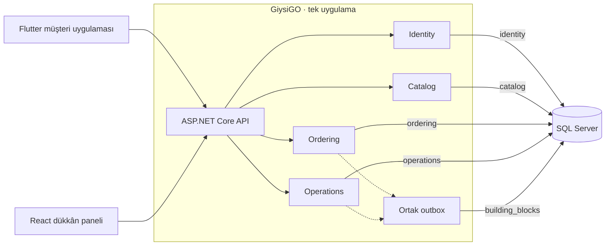
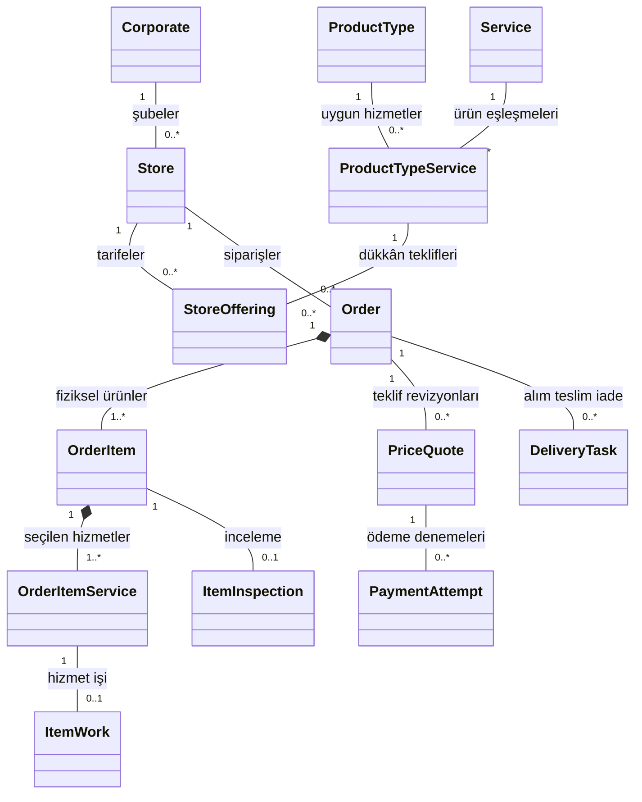

# GiysiGO

**Kuru temizleme ve giysi bakımı için sipariş, teklif ve teslimat platformu.**

GiysiGO, müşterinin adresine hizmet veren bir dükkân bulmasından ürünlerin geri teslimine kadar geçen süreci tek bir sipariş üzerinden takip etmeyi amaçlar. Müşteri ürünlerini ve hizmetlerini seçer, dükkân fiziksel incelemeden sonra kesin fiyatı hazırlar. Müşteri teklifi kabul ederse ödeme ve hizmet süreci başlar. Teklifi reddederse bütün ürünler için iade süreci açılır.

**Backend** ASP.NET Core · .NET 10 · Dapper · SQL Server

**Planlanan istemciler** Flutter müşteri uygulaması · React + TypeScript dükkân paneli

## MVP kapsamı ve geliştirme durumu

- **Müşteri** adresine uygun dükkânları bulur, ürün ve hizmetleri sepete ekler, kesin teklifi değerlendirir ve siparişini takip eder.
- **Dükkân** platform kataloğundan sunduğu hizmetleri ve tarifesini yönetir, gelen ürünleri inceler, kesin teklif hazırlar ve ödeme sonrası işleri takip eder.
- **Operasyon** alım, normal teslim ve teklif reddi sonrası iade görevlerini yönetir. İlk sürüm, kurye senaryolarını Development/Test ortamında mock verilerle, ödemeyi test sağlayıcısıyla doğrulamayı hedefler.

**Geliştirme durumu** API hostu, ortak sözleşmeler, SQL projesi, Identity ve Catalog veri erişimi, Ordering'in temel sipariş servisleri ve test altyapısı mevcut. Katalog seed ve yönetim API'si, oturum ve yetkilendirme, istemci uygulamaları ve otomatik operasyon akışları ayrı geliştirme işleri olarak takip ediliyor. Aşağıdaki diyagramlar hedef mimariyi ve iş akışını gösterir. [MVP takip planı](https://github.com/DOU-SEProjects/GiysiGO/issues/4) · [Proje panosu](https://github.com/orgs/DOU-SEProjects/projects/2/views/2)

## Ekip ve sorumluluklar

| Modül | Sorumlu | İş kapsamı |
| --- | --- | --- |
| **Identity** | [@PnterNN](https://github.com/PnterNN) | Kayıt ve oturum, roller ve izinler, müşteri adresleri, şirket ve dükkân üyelikleri. Flutter uygulama kabuğu, dükkân panelinde oturum ve ortak altyapı koordinasyonu. |
| **Catalog** | [@sdnrkaleli](https://github.com/sdnrkaleli) | Kategori, ürün tipi ve hizmet kataloğu. Dükkân keşfi, hizmet alanı, dükkâna özel hizmet ve fiyatlar. React panel kabuğu ve katalog ekranları. |
| **Ordering** | [@AhmetEfe0](https://github.com/AhmetEfe0) | Sepet, sipariş oluşturma, adres ve fiyat kopyaları, kesin teklif, müşteri kararı ve ödeme. Müşteri sipariş ekranları ve dükkân teklif ekranları. |
| **Operations** | [@selincellkk](https://github.com/selincellkk) | Kurye görevi ve atama, ürün incelemesi, hizmet işleri, teslim ve iade. Dükkân panelinde operasyon kuyruğu ve iş takibi. |

Her modül kendi C# kodunu, SQL şemasını ve testlerini yönetir. API hostu, CI ve modüller arası sözleşme değişiklikleri ilgili sahiplerle koordine edilir. [Ekip planı](docs/FOUR-PERSON-PLAN.md) · [CODEOWNERS](.github/CODEOWNERS)

## Mimari

GiysiGO tek ASP.NET Core API hostu ve dört iş modülünden oluşan **modüler bir monolittir**. Her modülün `Domain`, `Application`, `Infrastructure` ve `IntegrationEvents` projeleri vardır. Modüller ortak arayüzler ve entegrasyon olayları üzerinden haberleşir. Dapper, modüle ait stored procedure'leri çalıştırır. Sipariş gibi olay üreten işlemlerde iş kaydı ve outbox satırı aynı SQL transaction'ında yazılır.



[Modül sınırları](docs/ARCHITECTURE.md) · [Arayüzler ve transaction kuralları](docs/MODULE-CONTRACTS.md) · [Stored procedure kuralları](docs/STORED-PROCEDURE-CONVENTIONS.md)

## UML · Temel alan modeli

Şema, siparişin dükkân, hizmet, teklif, ödeme ve operasyon kayıtlarıyla ilişkisini iş kuralları düzeyinde özetler.



Her fiziksel ürün ayrı sipariş kalemidir. Checkout sırasında adres ve tahmini hizmet fiyatı siparişe kopyalanır. Kesin fiyat teklif revizyonunda saklanır. SQL projesi ve tablo rehberi alanlar, indeksler ve kısıtlar için referanstır. [Tablo rehberi](docs/TABLE-PURPOSES.md) · [SQL projesi](database/README.md)

## UML · Sipariş, teslim ve iade akışı

```mermaid
sequenceDiagram
    actor M as Müşteri
    participant C as Catalog
    participant O as Ordering
    participant OP as Operations
    actor D as Dükkân
    participant P as Test ödeme sağlayıcısı

    M->>C: Adrese ve hizmete göre dükkânları bul
    M->>O: Ürün ve hizmetleri sepete ekle, sipariş ver
    O->>C: Dükkânı, seçimi ve tarifeyi yeniden doğrula
    O-->>OP: OrderPlaced
    OP->>OP: Alım görevi aç ve uygun kuryeyi ata
    OP-->>O: PickupAtStore
    D->>OP: Fiziksel ürünleri tek tek incele
    OP-->>O: AllItemsInspected
    D->>O: Yetkili kullanıcı kesin teklifi yayımlar
    O-->>M: Kesin teklif

    alt Müşteri teklifi kabul eder
        M->>O: Teklifi kabul et ve ödeme başlat
        O->>P: Kabul edilen teklif tutarıyla ödeme iste
        P-->>O: Başarılı ödeme sonucu
        O-->>OP: PaymentSucceeded
        D->>OP: Ürün hizmetlerini tamamla
        OP-->>O: AllWorkCompleted
        O-->>OP: OrderReadyForDelivery
        OP-->>O: DeliveryCompleted
        O-->>M: Sipariş teslim edildi
    else Müşteri teklifi reddeder
        M->>O: Teklifin tamamını reddet
        O-->>OP: QuoteRejected
        OP->>OP: Bütün ürünler için iade görevi aç
        OP-->>O: ReturnCompleted
        O-->>M: Sipariş iade edildi
    end
```



Diyagramda adıyla gösterilen modüller arası olaylar outbox üzerinden iletilir. Tam durum geçişleri, izinler ve tekrar işleme kuralları akış sözleşmesinde yer alır. [Durum ve olay sözleşmesi](docs/WORKFLOW-CONTRACTS.md)

## Repo düzeni

| Dizin | İçerik |
| --- | --- |
| `src/API/GiysiGo.API` | API hostu, modül kayıtları, sağlık kontrolü ve OpenAPI |
| `src/Modules` | Identity, Catalog, Ordering ve Operations |
| `src/BuildingBlocks` | Ortak arayüzler, SQL transaction ve outbox altyapısı |
| `database/GiysiGo.Database` | SQL şemaları, tablolar, indeksler ve stored procedure'ler |
| `tests` | API, ortak sözleşme ve modül testleri |
| `docs` | Mimari, veri modeli, iş akışları ve ekip planı |

## Yerelde çalıştırma

1. **.NET 10 SDK**, **Visual Studio ve SSDT** ile **SQL Server veya LocalDB** kurun.
2. `GiysiGo.sln` içinden `GiysiGo.Database` projesini derleyin ve DACPAC'i yerel veritabanına yayınlayın. [Veritabanı kurulum adımları](database/README.md)
3. Repo kökünde yerel bağlantı ayarını verip API'yi çalıştırın.

```powershell
$env:ConnectionStrings__GiysiGo = 'Server=(localdb)\GiysiGo;Database=GiysiGo;Integrated Security=True;TrustServerCertificate=True'
dotnet run --project src/API/GiysiGo.API/GiysiGo.API.csproj
```

Varsayılan geliştirme profilinde API `http://localhost:5207` üzerinden açılır. Health kontrolü `/health`, geliştirme ortamındaki OpenAPI belgesi `/openapi/v1.json` yolundadır. [Örnek HTTP sözleşmesi](docs/openapi/mvp-contracts.json)

## Test ve katkı

```powershell
dotnet test tests/Contracts/GiysiGo.Contracts.Tests.csproj --configuration Release
dotnet test tests/API/GiysiGo.API.IntegrationTests/GiysiGo.API.IntegrationTests.csproj --configuration Release
```

CI, .NET testlerini çalıştırır ve Windows üzerinde DACPAC derleyip Catalog testlerini LocalDB ile doğrular. Bağlantı gerektiren diğer SQL testleri ayrılmış test veritabanıyla çalıştırılır. Kendi modülünüzün dalında ilerleyip değişiklikleri pull request ile incelemeye açın. [Test ve ortak başlangıç](docs/SHARED-START.md) · [Dal ve PR kuralları](docs/BRANCHING.md) · [CI iş akışı](.github/workflows/ci.yml)

Diğer belgeler için [dokümantasyon dizinine](docs/README.md) bakın.
