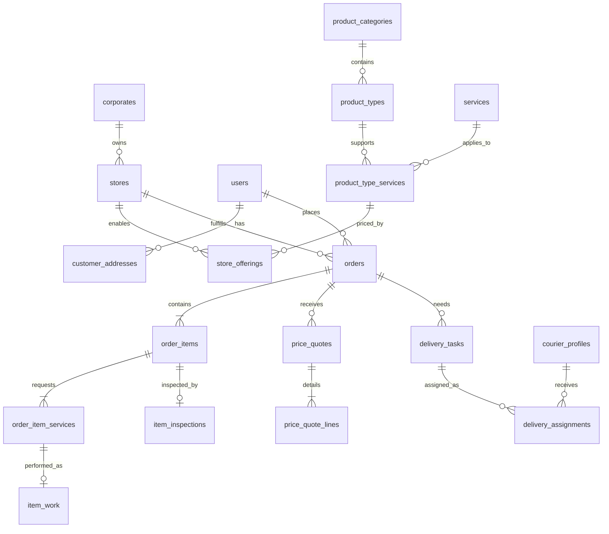

# GiysiGO PostgreSQL şeması

`schema.sql` boş bir PostgreSQL veritabanına uygulanacak referans DDL'dir. `.NET 10` uygulamasında her geliştirici kendi modülünün EF Core migration'larını bu yapıya göre üretir. Aynı veritabanında hem bu DDL hem migration'lar çalıştırılmaz.

```powershell
psql -v ON_ERROR_STOP=1 -d giysigo -f database/schema.sql
```

Dosya 4 iş şemasında 38 tablo ve `building_blocks.outbox_messages` altyapı tablosu oluşturur. Uygulama GUID değerlerini üretir; SQL seed veya mock kurye verisi içermez. Katalog girdileri `docs/catalog-draft.json` dosyasındadır. Fiyat birimi belirsiz üç perde hizmeti, doğrudan terzi girişindeki 16 işlem ve olası çift ücretli kombinasyonlar iş kuralları netleşince seed edilir.

Ana ilişkiler:



Şemada modüller arası foreign key bulunur fakat .NET modülleri diğer modülün entity sınıfını veya DbContext'ini referanslamaz. Başka modüllerin verilerini public contract ve integration event ile alır. `identity.store_assignments` tablosu `catalog.stores` kaydına bağlı olduğu için migration sırası plan dosyasında açıklanmıştır.

SQL'in sağlayamadığı kurallar application transaction'larında uygulanır: adresin müşteriye ait olması; sepet hizmetinin hem ürün tipine hem seçili dükkâna uygun olması; teklif ve ödeme tutarlarının satır toplamıyla eşleşmesi; izin verilen durum geçişleri; çakışan görevlerde kurye kapasitesi; rolün permission'ı ve şirket/dükkân kapsamı. Bu kontroller için entegrasyon testleri gereklidir.
